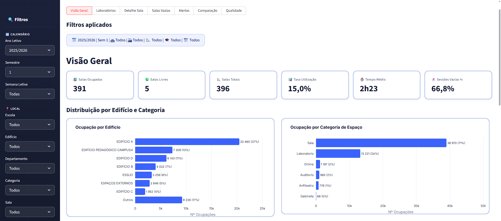
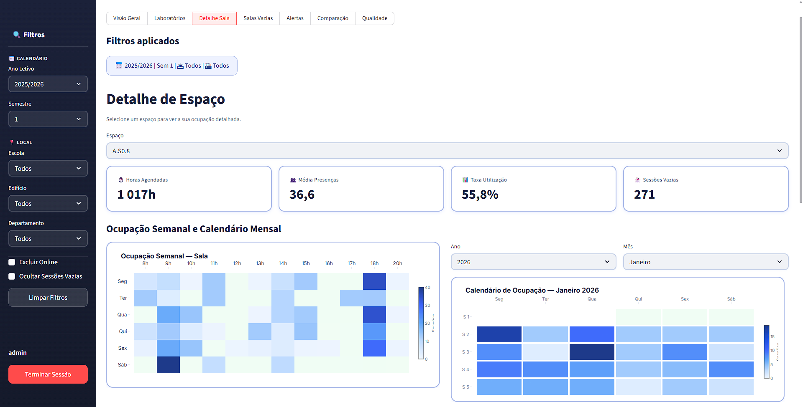
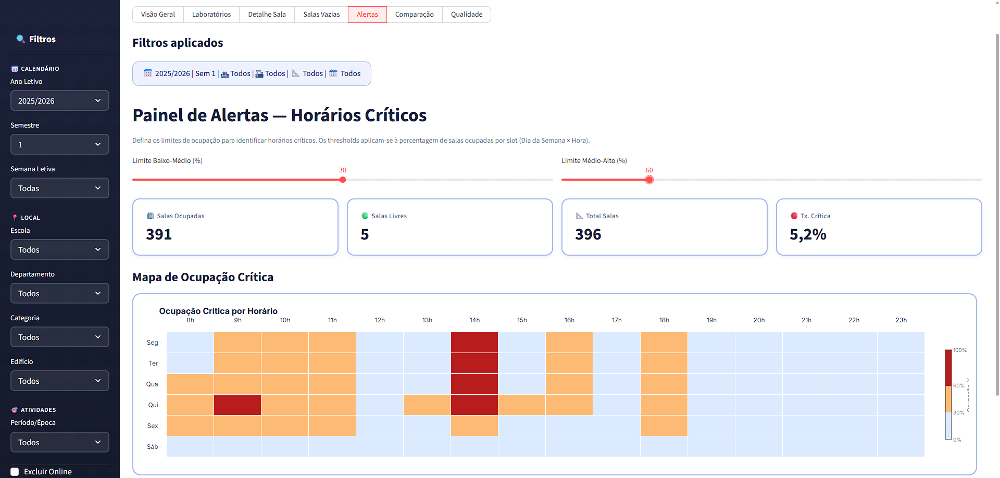
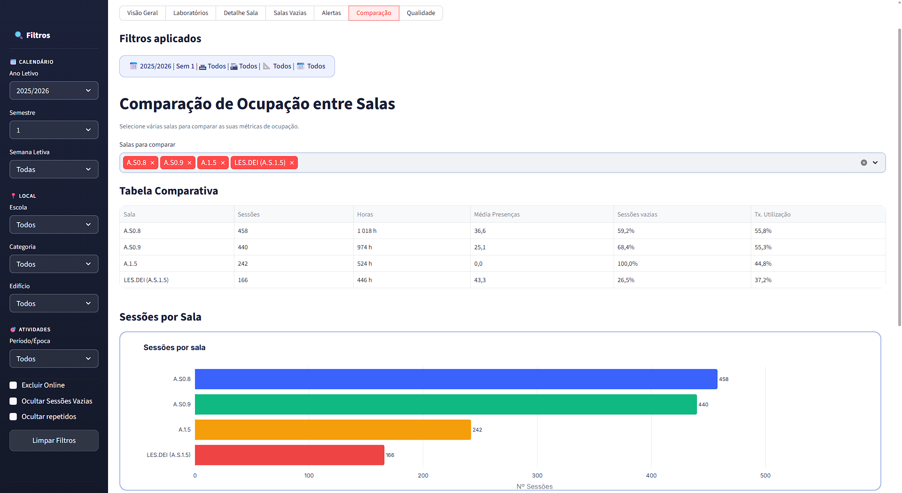
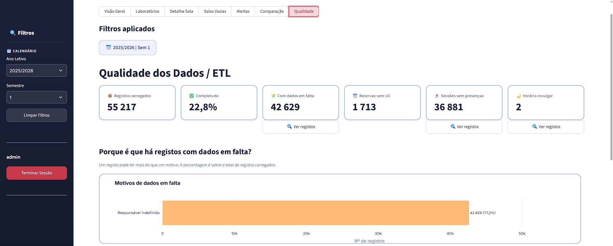
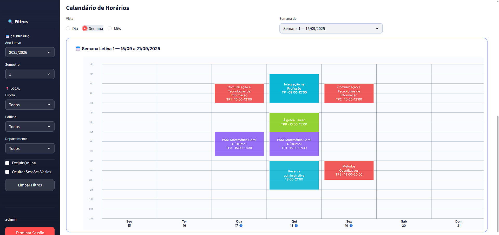
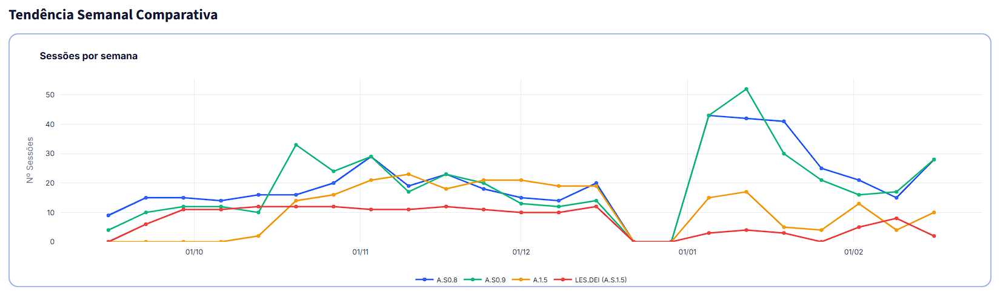
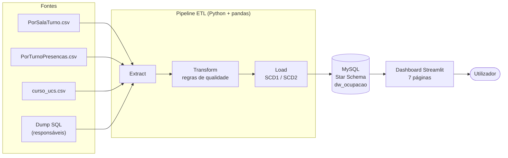

# Pipeline ETL e Dashboard BI — Análise de Ocupação ESTG

[](https://github.com/TiagoRuhle/Ocupacao-ESTG/actions/workflows/ci.yml)

## Visão Geral

Sistema de Extração, Transformação e Carregamento (ETL) para um Data Warehouse dimensional que suporta a análise de ocupação de espaços letivos da Escola Superior de Tecnologia e Gestão (ESTG). O pipeline processa dados brutos de agendamentos e assiduidade académica, materializando-os num modelo Star Schema em MySQL. Uma camada de Business Intelligence baseada em Streamlit disponibiliza visualizações interativas sobre os dados carregados.



## Capturas de ecrã

| Detalhe de uma sala | Alertas |
|---|---|
|  |  |

| Comparação de salas | Qualidade dos dados |
|---|---|
|  |  |

<details>
<summary>Calendário semanal de uma sala</summary>



</details>

<details>
<summary>Tendência semanal comparativa</summary>



</details>

## Arquitetura



## Enquadramento e Autores

Projeto realizado no âmbito da unidade curricular de **Projeto Informático** da Licenciatura em Engenharia Informática da Escola Superior de Tecnologia e Gestão (ESTG), Politécnico de Leiria, em 2025/2026.

**Autores:**

- Tiago Alexander de Oliveira Ruhle — [@TiagoRuhle](https://github.com/TiagoRuhle)
- André dos Santos Clérigo

**Orientação:** Professora Doutora Rosa Isabel Alves Cordeiro Matias e Professora Doutora Maria Beatriz Guerra da Piedade

---

## Pré-requisitos

- Python 3.10+
- MySQL Server 8.0+
- pip

### Dependências

Um único comando instala as dependências do pipeline ETL, do dashboard e dos testes:

```bash
pip install -r requirements.txt
```

---

## Configuração de Credenciais

Copiar `.env.example` para `.env` na raiz do repositório e preencher a password do MySQL:

```
DB_HOST=localhost
DB_PORT=3306
DB_USER=root
DB_PASSWORD=<password>
DB_NAME=dw_ocupacao

DASHBOARD_USER=admin
DASHBOARD_PASSWORD=estg2025

DADOS_PATH=processo_etl/Dados
FILE_AGENDAMENTOS=PorSalaTurno.csv
FILE_PRESENCAS=PorTurnoPresencas.csv
FILE_CURSOS=curso_ucs(in).csv
FILE_TURNOS_SQL=script_espacos_salas_turnos.sql
```

O mesmo ficheiro `.env` é utilizado pelo pipeline ETL, pelo dashboard e pelos testes. As variáveis `DADOS_PATH` e `FILE_*` indicam onde estão os ficheiros de origem; `DASHBOARD_USER` e `DASHBOARD_PASSWORD` definem o login do dashboard. Os testes de integração usam as mesmas credenciais MySQL (ou `TEST_DB_USER` / `TEST_DB_PASSWORD`, se definidas).

---

## Dados de Entrada

O pipeline espera os seguintes ficheiros no diretório indicado em `DADOS_PATH` (por omissão, `processo_etl/Dados/`):

| Ficheiro | Descrição | Encoding | Separador |
|---|---|---|---|
| `PorSalaTurno.csv` | Registo de agendamentos de espaços | `cp1252` | `,` |
| `PorTurnoPresencas.csv` | Registo de assiduidade académica | `cp1252` | `,` |
| `curso_ucs(in).csv` | Dicionário mestre de cursos e UCs | `latin-1` | `;` |
| `script_espacos_salas_turnos.sql` | Dump SQL com metadados de responsáveis | `utf-8` | — |

> Os dados de origem são institucionais e **não estão incluídos no repositório**.
>
> Os dados fornecidos não incluíam a correspondência entre as UCs agendadas e os respetivos cursos, por isso a maioria das aulas fica com o curso `N/D`. Não é um erro do pipeline: a métrica de completude da página **Qualidade** não conta o curso.

---

## Guia de Execução

> **Atenção:** Todos os comandos devem ser executados a partir da raiz do repositório.

### Passo 1 — Criar o Data Warehouse

Aplicar o script DDL ao servidor MySQL para criar a base de dados e todas as tabelas:

```bash
mysql -u root -p < database/schema_dw.sql
```

Este script cria a base de dados `dw_ocupacao` com o modelo Star Schema completo — dimensões, tabela de factos, colunas de controlo SCD2 (`Valid_From`, `Valid_To`, `Is_Active`) e chaves estrangeiras da `Facto_Ocupacao`.

Para os testes de integração, criar a base de dados de teste copiando a estrutura da `dw_ocupacao`:

```bash
mysql -u root -p -e "CREATE DATABASE IF NOT EXISTS dw_ocupacao_tests CHARACTER SET utf8mb4 COLLATE utf8mb4_unicode_ci;"
mysqldump -u root -p --no-data dw_ocupacao | mysql -u root -p dw_ocupacao_tests
```

Desta forma a `dw_ocupacao_tests` fica sempre com o mesmo schema que a `dw_ocupacao`, sem ter de aplicar o DDL duas vezes.

### Passo 2 — Validar o Schema com Testes

Antes de inserir qualquer dado, correr os testes para confirmar que o schema foi criado corretamente e que a lógica de carregamento funciona como esperado:

```bash
pytest tests/ -v
```

Estes testes cobrem:

- **`test_extract.py`** — normalização de colunas, limpeza de strings, leitura de CSV e parsing do dump SQL
- **`test_transform.py`** — regras de negócio, geração das dimensões de data e hora, classificação de espaços e épocas, pipeline de transformação completo
- **`test_load.py`** — ligação à BD de teste, inserção de dimensões SCD1/SCD2, integridade dos registos dummy SK=0, carregamento da tabela de factos
- **`test_plots.py`** — correção estrutural de todos os gráficos do dashboard (retornam sempre um `go.Figure`, incluindo com dados vazios)
- **`test_transforms.py`** — normalização de datas e docentes no dashboard
- **`test_queries.py`** — queries do dashboard contra a base de dados de teste
- **`test_auth.py`** — sessão de autenticação do dashboard
- **`test_utils_formato.py`** — formatação de números à portuguesa (`58 261`, `67,3%`)

> Os testes de `test_load.py` e `test_queries.py` requerem ligação ao MySQL com a base de dados `dw_ocupacao_tests` criada no passo anterior. Os restantes são puramente unitários, não precisam de base de dados e correm automaticamente no GitHub Actions em cada push.

**Só avançar para o passo seguinte se todos os testes passarem.**

### Passo 3 — Limpar o Data Warehouse

Antes da primeira carga (ou para reiniciar), executar o utilitário de limpeza:

```bash
python processo_etl/cleanup_dw.py
```

Este utilitário executa as seguintes operações:

1. Desativa as verificações de chave estrangeira
2. Trunca todas as tabelas dinâmicas
3. Reinsere os registos dummy com Surrogate Key igual a zero em todas as dimensões

### Passo 4 — Executar o Pipeline ETL

```bash
python processo_etl/main.py
```

O orquestrador coordena sequencialmente três fases:

- **Extração:** Lê os ficheiros CSV e o dump SQL, normalizando os nomes das colunas para `snake_case`.
- **Transformação:** Aplica regras de negócio — normalização de edifícios, imputação de valores nulos, extração de turnos por expressão regular, classificação de espaços e épocas, filtro de duração anómala, merge semântico de presenças e alinhamento com o schema do Data Warehouse.
- **Carregamento:** Insere ou atualiza dimensões (SCD tipo 1 e tipo 2), gera as dimensões estáticas (`Dim_Hora`, `Dim_Data`), e carrega a tabela de factos em lotes de 5000 registos.

O sistema produz registos de auditoria no terminal com volumes processados e métricas de integridade das Surrogate Keys. Os logs são também guardados em `processo_etl/dumpETL_<timestamp>.log`.

### Passo 5 — Lançar o Dashboard

```bash
streamlit run streamlit-dashboard/main.py
```

Inicia a interface BI no browser. As credenciais predefinidas são `admin` / `estg2025` e podem ser alteradas no `.env` (`DASHBOARD_USER` e `DASHBOARD_PASSWORD`).

O dashboard disponibiliza sete páginas:

| Página | Descrição |
|---|---|
| **Visão Geral** | KPIs, ocupação por edifício e categoria, período do dia, tipo de atividade, espaços mais e menos ocupados e série temporal |
| **Laboratórios** | Vista filtrada exclusivamente para espaços do tipo laboratório, com mapa de calor por hora |
| **Detalhe Sala** | Análise de um espaço: KPIs, mapas de ocupação semanal e mensal e calendário diário, semanal e mensal |
| **Salas Vazias** | Espaços livres num dia e intervalo de horas escolhidos |
| **Alertas** | Mapa de ocupação crítica por dia e hora, com limites ajustáveis, e lista dos horários mais carregados |
| **Comparação** | Tabela comparativa, sessões por sala e tendência semanal de várias salas |
| **Qualidade** | Completude dos registos, motivos de dados em falta, sessões sem presenças e registo de auditoria |

---

## Arquitetura dos Módulos

| Módulo | Responsabilidade |
|---|---|
| `processo_etl/extract.py` | Ingestão de dados a partir de CSV e SQL dump |
| `processo_etl/transform.py` | Regras de transformação e limpeza |
| `processo_etl/load.py` | Materialização no MySQL com gestão de Surrogate Keys |
| `processo_etl/main.py` | Orquestrador do pipeline |
| `processo_etl/cleanup_dw.py` | Utilitário de limpeza e reposição de dummies |
| `streamlit-dashboard/` | Aplicação Streamlit para visualização BI |
| `tests/` | Testes unitários e de integração |

---

## Modelo Dimensional (Star Schema)

A `Facto_Ocupacao` encontra-se no centro do esquema, relacionando-se com dez dimensões:

| Dimensão | Descrição |
|---|---|
| `Dim_Data` | Calendário académico (2018-01-01 a 2035-12-31) com ano letivo, semestre, tipo de semana e tipo de dia |
| `Dim_Hora` | Relógio de 0 a 2359 |
| `Dim_Espaco` | Edifício, sala, categoria, escola responsável, indicador online |
| `Dim_Unidade_Curricular` | Código, designação, ciclo de estudos (SCD tipo 2) |
| `Dim_Curso` | Código e nome (SCD tipo 2) |
| `Dim_Responsavel` | Docente responsável |
| `Dim_Turno` | Designação do turno |
| `Dim_Tipo_Atividade` | Designação da atividade |
| `Dim_Estado_Agendamento` | Estado do agendamento |
| `Dim_Epoca` | Descrição da época letiva |

Métricas armazenadas na `Facto_Ocupacao`: `Duracao_Minutos`, `Numero_Presencas`, `Flag_Evento_Agregado`.

---

## Estratégia SCD

| Tipo | Dimensões |
|---|---|
| SCD Tipo 2 | `Dim_Espaco`, `Dim_Unidade_Curricular`, `Dim_Curso` |
| SCD Tipo 1 | `Dim_Responsavel`, `Dim_Turno`, `Dim_Tipo_Atividade`, `Dim_Estado_Agendamento`, `Dim_Epoca` |

---

## Regras de Qualidade Aplicadas

1. Normalização de edifícios — remoção de sufixos entre parênteses
2. Imputação de responsáveis — `'Indefinido/N.D.'` para registos nulos
3. Reservas sem código curricular — mapeadas para `'SEM_UNIDADE / RESERVA_ADMIN'`
4. Extração de turno via regex — valores não correspondentes recebem `'N/D'`
5. Sessões online detetadas por palavras-chave no edifício ou estado
6. Sessões com duração ≤ 0 ou > 360 minutos eliminadas
7. Merge de presenças por chave semântica (data, nome da UC, turno)
8. `Codigo_UC` tratado como string com remoção de sufixo decimal